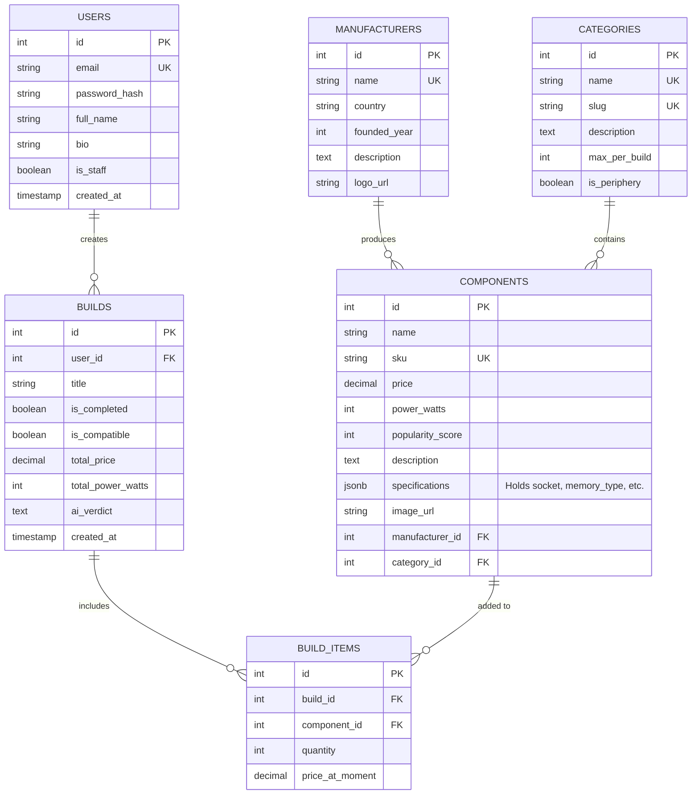

# RigCraft — Custom PC Builder & Hardware Platform

## Project Overview (Business Logic & Concept)

**RigCraft** is a web platform designed for exploring computer hardware, peripherals, and planning custom PC builds. The service allows users to browse a catalog of components (from CPUs and power supplies to monitors), compare specifications, assemble hardware configurations in a virtual workbench with automated compatibility validation, and receive AI-powered build reviews and tailored part recommendations.

### Core Features:
1. **Hardware & Peripherals Catalog:**
   - Main catalog page displaying all available PC parts and peripherals.
   - Search functionality by component name or model code (SKU).
   - Filtering by hardware category (CPUs, GPUs, Motherboards, etc.) and manufacturer.
   - Sorting options: by price (lowest to highest, highest to lowest), popularity, power consumption, and category.
   - Dedicated component details page showing full technical specifications, description, price, power requirements, manufacturer info, and category.
2. **Manufacturers Directory:**
   - A page listing all hardware brands available on the platform (AMD, NVIDIA, ASUS, Kingston, etc.).
   - Individual manufacturer pages containing brand details and a list of all their components available in the catalog.
3. **Hardware Categories & Build Quotas:**
   - A page listing all equipment categories with explanations of each component's role in a PC and the maximum allowed quantity of that category in a single build (`max_per_build`, e.g., 1 CPU, 1 Motherboard, up to 4 RAM modules).
   - Individual category pages displaying all catalog items belonging to that specific type.
4. **Catalog Management:**
   - Ability to add, edit, and delete catalog entities (components, manufacturers, and categories).
5. **User Accounts & Profile:**
   - User registration and login functionality.
   - Personal profile page where authenticated users can view and edit their personal information and review their history of completed PC builds.
6. **PC Workbench (Cart) & Saved Builds (Orders):**
   - Authenticated users have an active draft build (workbench) where they can add components from the catalog, adjust quantities within category limits, or remove items.
   - Clicking the "Complete Build" button locks the current draft into a finalized build record in the user's profile history.
7. **Automated Compatibility Engine:**
   - Every workbench and saved build is validated against strict hardware compatibility rules:
     - **CPU & Motherboard Socket:** The processor's `socket` must match the motherboard's `socket` (e.g., `AM5` = `AM5`).
     - **RAM & Motherboard Memory Type:** The memory's `memory_type` (`DDR4` / `DDR5`) must match the type supported by the motherboard.
     - **Motherboard & Case Form Factor:** The motherboard's `form_factor` (`ATX`, `Micro-ATX`, `Mini-ITX`) must be included in the PC case's `supported_form_factors` list.
     - **Cooler & CPU Socket:** The CPU cooler's `supported_sockets` list must include the processor's `socket`.
     - **Power Supply Headroom:** The PSU's rated wattage (`wattage`) must be greater than or equal to the build's total estimated power consumption (`total_power_watts`) plus a safety margin (recommended at least +20% headroom).
     - **Category Quantity Limits:** The number of items in a specific category cannot exceed `category.max_per_build`.
8. **Smart Build Assistant (LLM Integration):**
   - **AI Build Review:** Analyzes a PC build alongside its compatibility report and generates a natural-language summary evaluating part synergy, potential CPU/GPU bottlenecks, and optimal use cases.
   - **AI Part Picker:** Suggests a compatible set of components from the catalog based on a user's natural language prompt and target budget.
9. **"About Us" Page:**
   - Static information page containing platform details, contact information, delivery terms, and return policies.

---

## Database Schema



---

## REST API Architecture & Documentation

All requests and responses use `application/json`.

---

### 1. Components (`/api/components`)

#### `GET /api/components`
* **Usage:** Retrieve a list of hardware components with search, filtering, and sorting for the main catalog page.
* **Request Method:** `GET`
* **Query Parameters (optional):**
  * `search` (string) — search by component name or SKU.
  * `category_id` (int) — filter by category ID.
  * `manufacturer_id` (int) — filter by manufacturer ID.
  * `sort_by` (string) — `price`, `popularity`, `power_watts`, or `category`.
  * `order` (string) — `asc` or `desc`.
* **Response Status:** `200 OK`
* **Response Body:**
```json
[
  {
    "id": 101,
    "name": "AMD Ryzen 7 7800X3D",
    "sku": "100-100000910WOF",
    "price": 420.00,
    "power_watts": 120,
    "popularity_score": 98,
    "image_url": "https://example.com/images/r7-7800x3d.jpg",
    "manufacturer": { "id": 1, "name": "AMD" },
    "category": { "id": 1, "name": "Processors" }
  }
]
```

#### `GET /api/components/{id}`
* **Usage:** Retrieve full details and specifications of a single component for its dedicated page.
* **Request Method:** `GET`
* **URL Parameters:** `id` (int) — component ID.
* **Response Status:** `200 OK` (or `404 Not Found`)
* **Response Body:**
```json
{
  "id": 101,
  "name": "AMD Ryzen 7 7800X3D",
  "sku": "100-100000910WOF",
  "price": 420.00,
  "power_watts": 120,
  "popularity_score": 98,
  "description": "8-core, 16-thread desktop processor with 3D V-Cache technology.",
  "specifications": {
    "socket": "AM5",
    "cores": 8,
    "threads": 16,
    "base_clock_ghz": 4.2
  },
  "image_url": "https://example.com/images/r7-7800x3d.jpg",
  "manufacturer": { "id": 1, "name": "AMD" },
  "category": { "id": 1, "name": "Processors", "max_per_build": 1 }
}
```

#### `POST /api/components`
* **Usage:** Add a new component to the catalog.
* **Request Method:** `POST`
* **Request Body:**
```json
{
  "name": "ASUS TUF GAMING B650-PLUS",
  "sku": "90MB1BZ0-M0EAY0",
  "price": 210.00,
  "power_watts": 45,
  "description": "AMD B650 ATX motherboard with DDR5 support.",
  "specifications": {
    "socket": "AM5",
    "memory_type": "DDR5",
    "form_factor": "ATX",
    "memory_slots": 4
  },
  "image_url": "https://example.com/images/b650-plus.jpg",
  "manufacturer_id": 3,
  "category_id": 2
}
```
* **Response Status:** `201 Created`
* **Response Body:** Created component object with assigned `id`.

#### `PUT /api/components/{id}`
* **Usage:** Update an existing component's details.
* **Request Method:** `PUT`
* **URL Parameters:** `id` (int) — component ID.
* **Request Body:** Updated component fields (same structure as `POST`).
* **Response Status:** `200 OK`
* **Response Body:** Updated component object.

#### `DELETE /api/components/{id}`
* **Usage:** Delete a component from the catalog.
* **Request Method:** `DELETE`
* **URL Parameters:** `id` (int) — component ID.
* **Response Status:** `204 No Content`
* **Response Body:** None.

---

### 2. Manufacturers (`/api/manufacturers`)

#### `GET /api/manufacturers`
* **Usage:** Retrieve a list of all hardware manufacturers.
* **Request Method:** `GET`
* **Response Status:** `200 OK`
* **Response Body:**
```json
[
  {
    "id": 1,
    "name": "AMD",
    "country": "USA",
    "founded_year": 1969,
    "logo_url": "https://example.com/logos/amd.png"
  }
]
```

#### `GET /api/manufacturers/{id}`
* **Usage:** Retrieve manufacturer details along with all available components from this brand.
* **Request Method:** `GET`
* **URL Parameters:** `id` (int) — manufacturer ID.
* **Response Status:** `200 OK`
* **Response Body:**
```json
{
  "id": 1,
  "name": "AMD",
  "country": "USA",
  "founded_year": 1969,
  "description": "Semiconductor company developing processors and graphics technologies.",
  "logo_url": "https://example.com/logos/amd.png",
  "components": [
    {
      "id": 101,
      "name": "AMD Ryzen 7 7800X3D",
      "price": 420.00,
      "category_name": "Processors"
    }
  ]
}
```

#### `POST /api/manufacturers`
* **Usage:** Add a new manufacturer.
* **Request Method:** `POST`
* **Request Body:**
```json
{
  "name": "Be Quiet!",
  "country": "Germany",
  "founded_year": 2001,
  "description": "Manufacturer of quiet power supplies, cases, and cooling solutions.",
  "logo_url": "https://example.com/logos/bequiet.png"
}
```
* **Response Status:** `201 Created`
* **Response Body:** Created manufacturer object.

#### `PUT /api/manufacturers/{id}`
* **Usage:** Update manufacturer details.
* **Request Method:** `PUT`
* **URL Parameters:** `id` (int) — manufacturer ID.
* **Request Body:** Updated manufacturer fields.
* **Response Status:** `200 OK`
* **Response Body:** Updated manufacturer object.

#### `DELETE /api/manufacturers/{id}`
* **Usage:** Delete a manufacturer.
* **Request Method:** `DELETE`
* **URL Parameters:** `id` (int) — manufacturer ID.
* **Response Status:** `204 No Content`
* **Response Body:** None.

---

### 3. Categories (`/api/categories`)

#### `GET /api/categories`
* **Usage:** Retrieve a list of all hardware and peripheral categories with their build limits.
* **Request Method:** `GET`
* **Response Status:** `200 OK`
* **Response Body:**
```json
[
  {
    "id": 1,
    "name": "Processors",
    "slug": "cpus",
    "description": "Central processing units.",
    "max_per_build": 1,
    "is_periphery": false
  },
  {
    "id": 3,
    "name": "Memory (RAM)",
    "slug": "ram",
    "description": "System volatile memory modules.",
    "max_per_build": 4,
    "is_periphery": false
  }
]
```

#### `GET /api/categories/{id}`
* **Usage:** Retrieve category details and all components belonging to it.
* **Request Method:** `GET`
* **URL Parameters:** `id` (int) — category ID.
* **Response Status:** `200 OK`
* **Response Body:**
```json
{
  "id": 1,
  "name": "Processors",
  "slug": "cpus",
  "description": "Central processing units.",
  "max_per_build": 1,
  "is_periphery": false,
  "components": [
    {
      "id": 101,
      "name": "AMD Ryzen 7 7800X3D",
      "price": 420.00,
      "manufacturer_name": "AMD"
    }
  ]
}
```

#### `POST /api/categories`
* **Usage:** Create a new hardware category.
* **Request Method:** `POST`
* **Request Body:**
```json
{
  "name": "Power Supplies",
  "slug": "power-supplies",
  "description": "Power supply units for internal components.",
  "max_per_build": 1,
  "is_periphery": false
}
```
* **Response Status:** `201 Created`
* **Response Body:** Created category object.

#### `PUT /api/categories/{id}`
* **Usage:** Update an existing category.
* **Request Method:** `PUT`
* **URL Parameters:** `id` (int) — category ID.
* **Request Body:** Updated category fields.
* **Response Status:** `200 OK`
* **Response Body:** Updated category object.

#### `DELETE /api/categories/{id}`
* **Usage:** Delete a category.
* **Request Method:** `DELETE`
* **URL Parameters:** `id` (int) — category ID.
* **Response Status:** `204 No Content`
* **Response Body:** None.

---

### 4. Authentication & User Profile (`/api/auth`, `/api/users`)

#### `POST /api/auth/register`
* **Usage:** Register a new user account.
* **Request Method:** `POST`
* **Request Body:**
```json
{
  "email": "user@example.com",
  "password": "StrongPassword123!",
  "full_name": "Alex Mercer"
}
```
* **Response Status:** `201 Created`
* **Response Body:**
```json
{
  "id": 7,
  "email": "user@example.com",
  "full_name": "Alex Mercer"
}
```

#### `POST /api/auth/login`
* **Usage:** Authenticate a user and obtain a token.
* **Request Method:** `POST`
* **Request Body:**
```json
{
  "email": "user@example.com",
  "password": "StrongPassword123!"
}
```
* **Response Status:** `200 OK` (or `401 Unauthorized`)
* **Response Body:**
```json
{
  "access_token": "eyJhbGciOiJIUzI1NiIsInR5cCI6IkpXVCJ9...",
  "token_type": "Bearer"
}
```

#### `GET /api/users/me`
* **Usage:** Retrieve the current authenticated user's profile data.
* **Request Method:** `GET`
* **Response Status:** `200 OK`
* **Response Body:**
```json
{
  "id": 7,
  "email": "user@example.com",
  "full_name": "Alex Mercer",
  "bio": "Building quiet workstations and custom gaming rigs."
}
```

#### `PATCH /api/users/me`
* **Usage:** Edit personal profile details.
* **Request Method:** `PATCH`
* **Request Body:**
```json
{
  "full_name": "Alex M.",
  "bio": "Interested in PC architecture and deep learning workstations."
}
```
* **Response Status:** `200 OK`
* **Response Body:** Updated user profile object.

---

### 5. PC Builds & Active Workbench (`/api/builds`)

*(Note: A user's active workbench/cart is a Build with `is_completed: false`. It automatically runs compatibility checks on added components).*

#### `GET /api/builds/current`
* **Usage:** Retrieve the user's current unfinished build (workbench) with calculated totals and real-time compatibility check results.
* **Request Method:** `GET`
* **Response Status:** `200 OK`
* **Response Body:**
```json
{
  "id": 501,
  "title": "Draft Build",
  "is_completed": false,
  "is_compatible": true,
  "compatibility_issues": [],
  "total_price": 630.00,
  "total_power_watts": 165,
  "recommended_psu_watts": 250,
  "items": [
    {
      "item_id": 12,
      "quantity": 1,
      "component": {
        "id": 101,
        "name": "AMD Ryzen 7 7800X3D",
        "category_name": "Processors",
        "price": 420.00,
        "power_watts": 120
      }
    },
    {
      "item_id": 13,
      "quantity": 1,
      "component": {
        "id": 102,
        "name": "ASUS TUF GAMING B650-PLUS",
        "category_name": "Motherboards",
        "price": 210.00,
        "power_watts": 45
      }
    }
  ]
}
```

#### `POST /api/builds/current/items`
* **Usage:** Add a component to the current workbench build (validates against `max_per_build` limit).
* **Request Method:** `POST`
* **Request Body:**
```json
{
  "component_id": 205,
  "quantity": 2
}
```
* **Response Status:** `201 Created` (or `400 Bad Request` if `max_per_build` is exceeded)
* **Response Body:** Updated workbench build object including updated `is_compatible` and `compatibility_issues`.

#### `PATCH /api/builds/current/items/{item_id}`
* **Usage:** Update the quantity of a component in the workbench (validates against `max_per_build`).
* **Request Method:** `PATCH`
* **URL Parameters:** `item_id` (int) — build item ID.
* **Request Body:**
```json
{
  "quantity": 4
}
```
* **Response Status:** `200 OK` (or `400 Bad Request` if limit exceeded)
* **Response Body:** Updated workbench build object.

#### `DELETE /api/builds/current/items/{item_id}`
* **Usage:** Remove a component from the current workbench build.
* **Request Method:** `DELETE`
* **URL Parameters:** `item_id` (int) — build item ID.
* **Response Status:** `204 No Content`
* **Response Body:** None.

#### `POST /api/builds/current/checkout`
* **Usage:** Finalize and save the current workbench into the user's completed builds history (sets `is_completed = true`).
* **Request Method:** `POST`
* **Request Body:**
```json
{
  "title": "ML & 1440p Gaming Rig"
}
```
* **Response Status:** `200 OK`
* **Response Body:** Finalized build object with `is_completed: true`.

#### `GET /api/builds`
* **Usage:** Retrieve the authenticated user's history of completed PC builds for the profile page.
* **Request Method:** `GET`
* **Response Status:** `200 OK`
* **Response Body:** Array of completed build objects.

#### `GET /api/builds/{id}`
* **Usage:** Retrieve detailed information about a specific saved build, including its compatibility report and AI verdict.
* **Request Method:** `GET`
* **URL Parameters:** `id` (int) — build ID.
* **Response Status:** `200 OK`
* **Response Body:** Full build object.

---

### 6. AI Build Assistant (`/api/builds/{id}/ai-review`, `/api/ai/suggest-build`)

#### `POST /api/builds/{id}/ai-review`
* **Usage:** Generate an LLM evaluation of a build (analyzing part balance, bottlenecks, and value for money alongside the compatibility report) and save it to `ai_verdict`.
* **Request Method:** `POST`
* **URL Parameters:** `id` (int) — build ID.
* **Request Body:** None.
* **Response Status:** `200 OK`
* **Response Body:**
```json
{
  "build_id": 501,
  "is_compatible": true,
  "ai_verdict": "All components are hardware-compatible (AM5 socket, DDR5 memory, ATX form factor). The Ryzen 7 7800X3D paired with the B650 chipset provides an optimal gaming foundation with zero bottlenecking."
}
```

#### `POST /api/ai/suggest-build`
* **Usage:** Automatically pick a hardware-compatible set of components from the catalog based on user requirements and maximum budget.
* **Request Method:** `POST`
* **Request Body:**
```json
{
  "prompt": "Quiet PC for computer vision tasks in PyTorch and 1440p gaming",
  "max_budget": 1600.00
}
```
* **Response Status:** `200 OK`
* **Response Body:**
```json
{
  "explanation": "Selected an AM5 processor, a matching B650 ATX motherboard, and an NVIDIA GPU with 16GB VRAM for CUDA workloads, powered by an 850W PSU (providing 40% headroom over estimated wattage).",
  "estimated_total_price": 1470.00,
  "estimated_power_watts": 510,
  "suggested_components": [
    {
      "id": 101,
      "name": "AMD Ryzen 7 7800X3D",
      "category_name": "Processors",
      "price": 420.00
    },
    {
      "id": 102,
      "name": "ASUS TUF GAMING B650-PLUS",
      "category_name": "Motherboards",
      "price": 210.00
    },
    {
      "id": 304,
      "name": "NVIDIA GeForce RTX 4070 Ti Super",
      "category_name": "Graphics Cards",
      "price": 840.00
    }
  ]
}
```