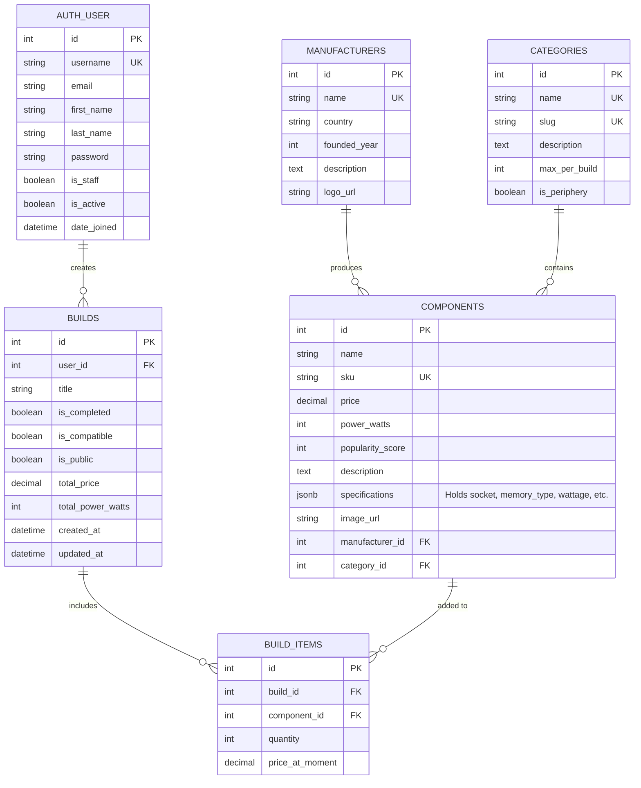

# Kompo — Custom PC Builder & Hardware Platform

## Project Overview (Business Logic & Concept)

**Kompo** is a web platform designed for exploring computer hardware, peripherals, and planning custom PC builds. The service allows users to browse a catalog of components (from CPUs and power supplies to monitors), compare specifications, assemble hardware configurations in a virtual workbench with automated compatibility validation, publish completed builds to a community showcase, and receive AI-powered build reviews and tailored part recommendations.

### Core Features:

1. **Hardware & Peripherals Catalog:**
   - Main catalog page displaying all available PC parts and peripherals.
   - Search functionality by component name or model code (SKU).
   - Filtering by hardware category (CPUs, GPUs, Motherboards, etc.) and manufacturer.
   - Sorting options: by price (lowest to highest, highest to lowest), popularity, power consumption, and category.
   - Dedicated component details page showing full technical specifications, description, price, power requirements, manufacturer info, and category.

2. **Manufacturers Directory:**
   - A page listing all hardware brands available on the platform (AMD, NVIDIA, ASUS, Kingston, etc.).
   - Individual manufacturer pages containing brand details and a list of all their components available in the catalog.

3. **Hardware Categories & Build Quotas:**
   - A page listing all equipment categories with explanations of each component's role in a PC and the maximum allowed quantity of that category in a single build (`max_per_build`, e.g., 1 CPU, 1 Motherboard, up to 4 RAM modules).
   - Individual category pages displaying all catalog items belonging to that specific type.

4. **Role-Based Catalog Management:**
   - Public read-only access (`GET`) to components, manufacturers, and categories for all visitors.
   - Staff/Administrator (`is_staff = true`) privileges required to create, update, or delete catalog entities (`POST`, `PUT`, `PATCH`, `DELETE`), protected by referential conflict checks (`409 Conflict` when deleting manufacturers or categories that still contain components).

5. **JWT Authentication & User Accounts:**
   - User registration with strong password validation and immediate JWT token issuance (`access` + `refresh`).
   - JWT token refresh with automatic token rotation and blacklisting of old refresh tokens.
   - Personal profile endpoint (`/api/users/me`) returning authenticated user details and staff status.

6. **PC Workbench (Cart), Saved Builds & Public Showcase:**
   - Authenticated users have a single active draft build (`is_completed = false`) acting as a virtual workbench where they can add components, update quantities within category limits, or remove items.
   - Checking out (`/api/builds/current/checkout`) locks component prices (`price_at_moment`), marks the build as completed (`is_completed = true`), and optionally makes it public (`is_public = true`).
   - Users can view their completed build history, toggle visibility (`is_public`) or rename their completed builds, and delete builds they own.
   - Unauthenticated guests and users can browse, search, filter, and sort public completed builds via `/api/builds/public`.

7. **Automated Compatibility Engine:**
   - Every workbench and saved build is validated in real time against strict hardware compatibility rules:
     - **CPU & Motherboard Socket:** The processor's `socket` must match the motherboard's `socket` (e.g., `AM5` = `AM5`).
     - **RAM & Motherboard Memory Type:** The memory's `memory_type` (`DDR4` / `DDR5`) must match the type supported by the motherboard.
     - **Motherboard & Case Form Factor:** The motherboard's `form_factor` (`ATX`, `Micro-ATX`, `Mini-ITX`) must be included in the PC case's `supported_form_factors` list.
     - **Cooler & CPU Socket:** The CPU cooler's `supported_sockets` list must include the processor's `socket`.
     - **Power Supply Headroom:** The PSU's rated wattage (`wattage`) must be greater than or equal to the build's total estimated power consumption (`total_power_watts`) plus a +20% safety margin (`recommended_psu_watts` is rounded up to the nearest 50W increment, minimum 250W when power draw > 0).
     - **Category Quantity Limits:** The total number of items in a specific category cannot exceed `category.max_per_build`.

8. **Smart Build Assistant (LLM Integration — Planned):**
   - **AI Build Review:** Analyzes a PC build alongside its compatibility report and generates a natural-language summary evaluating part synergy, potential CPU/GPU bottlenecks, and optimal use cases.
   - **AI Part Picker:** Suggests a compatible set of components from the catalog based on a user's natural language prompt and target budget.

---

## Getting Started (How to Run the Project)

### Prerequisites

- **Python 3.12+** installed on your machine
- **pip** (Python package manager)

### 1. Clone the Repository & Navigate to the Project Directory

```bash
git clone https://github.com/elvvelon/Kompo.git
cd Kompo
```

### 2. Create and Activate a Virtual Environment

macOS / Linux:

```bash
python3 -m venv venv
source venv/bin/activate
```

Windows:

```bash
python -m venv venv
venv\Scripts\activate
```

### 3. Install Dependencies

Install all required packages from the dependencies file:

```bash
pip install -r requirements.txt
```

### 4. Apply Database Migrations

Initialize the database schema by running Django migrations:

```bash
python manage.py migrate
```

### 5. Seed Initial Data (Optional)

Populate the database with initial hardware manufacturers, categories, and sample PC components:

```bash
python manage.py seed_data
```

### 6. Create a Superuser (Optional)

To access the Django Admin panel and test admin-only catalog write endpoints (`POST`, `PUT`, `PATCH`, `DELETE`), create an administrator account:

```bash
python manage.py createsuperuser
```

### 7. Run the Development Server

Start the local Django development server:

```bash
python manage.py runserver
```

Once the server is running, you can access:

- **REST API Base URL:** `http://127.0.0.1:8000/api/`
- **Django Admin Panel:** `http://127.0.0.1:8000/admin/`

### 8. Running Tests & Postman Collection

- **Automated Unit Tests:** Run the test suite across `hardware`, `users`, and `builds` apps to verify API endpoints, permissions, compatibility engine, and error handling:
  ```bash
  python manage.py test
  ```
- **Postman Collection:** Import `postman/KompoAPI.postman_collection.json` into Postman and set the `base_url` collection variable to `http://127.0.0.1:8000` (and `access_token` / `refresh_token` after registering or logging in) to test all endpoints interactively.

---

## Database Schema



---

## REST API Architecture & Documentation

### Headers, Authentication & Unified Error Format

- **Content-Type:** All JSON requests and responses use `Content-Type: application/json` (and `Accept: application/json`).
- **JWT Authentication:** Protected endpoints require a valid JSON Web Token passed via the HTTP `Authorization` header using the `Bearer` scheme:
  ```http
  Authorization: Bearer <access_token>
  ```
- **Token Lifetimes & Rotation:**
  - `access` token lifetime: **15 minutes**.
  - `refresh` token lifetime: **7 days** (with `ROTATE_REFRESH_TOKENS = True` and `BLACKLIST_AFTER_ROTATION = True`).
- **Unified Error Response Format:** Every error (`400`, `401`, `403`, `404`, `409`) returned by DRF views or custom handlers follows a consistent envelope:
  ```json
  {
    "error": {
      "status_code": 400,
      "code": "validation_error",
      "message": "Validation error — price: Price must be greater than zero.",
      "details": {
        "price": ["Price must be greater than zero."]
      }
    }
  }
  ```

---

### 1. Authentication & User Profile (`/api/users`)

#### `POST /api/users/register`
- **Usage:** Register a new user account and immediately receive JWT `access` and `refresh` tokens.
- **Permissions:** `AllowAny` (Public).
- **Headers:** `Content-Type: application/json`
- **Request Body:**
  ```json
  {
    "username": "vvelon_builder",
    "first_name": "Danylo",
    "last_name": "Maister",
    "email": "vvelon@example.com",
    "password": "StrongPassword123!",
    "password_confirmation": "StrongPassword123!"
  }
  ```
  *(Note: `first_name` and `last_name` are optional; `password` must be 8–128 characters and pass Django password validators).*
- **Response Status:** `201 Created` (or `400 Bad Request` on validation failure / duplicate username or email).
- **Response Body (`201 Created`):**
  ```json
  {
    "user": {
      "id": 7,
      "username": "vvelon_builder",
      "email": "vvelon@example.com",
      "first_name": "Danylo",
      "last_name": "Maister"
    },
    "access": "eyJhbGciOiJIUzI1NiIsInR5cCI6IkpXVCJ9...",
    "refresh": "eyJhbGciOiJIUzI1NiIsInR5cCI6IkpXVCJ9..."
  }
  ```

#### `POST /api/users/token/refresh/`
- **Usage:** Obtain a new `access` token and rotated `refresh` token (the previous `refresh` token is blacklisted).
- **Permissions:** `AllowAny` (Requires valid non-blacklisted refresh token in body).
- **Headers:** `Content-Type: application/json`
- **Request Body:**
  ```json
  {
    "refresh": "eyJhbGciOiJIUzI1NiIsInR5cCI6IkpXVCJ9..."
  }
  ```
- **Response Status:** `200 OK` (or `401 Unauthorized` if token is invalid, expired, or blacklisted).
- **Response Body (`200 OK`):**
  ```json
  {
    "access": "eyJhbGciOiJIUzI1NiIsInR5cCI6IkpXVCJ9...",
    "refresh": "eyJhbGciOiJIUzI1NiIsInR5cCI6IkpXVCJ9..."
  }
  ```

#### `GET /api/users/me`
- **Usage:** Retrieve the currently authenticated user's profile information and staff status.
- **Permissions:** `IsAuthenticated` (Requires valid `Authorization: Bearer <access_token>` header).
- **Headers:**
  - `Authorization: Bearer <access_token>`
- **Response Status:** `200 OK` (or `401 Unauthorized`).
- **Response Body (`200 OK`):**
  ```json
  {
    "id": 7,
    "username": "vvelon_builder",
    "email": "vvelon@example.com",
    "first_name": "Danylo",
    "last_name": "Maister",
    "is_staff": false
  }
  ```

#### `POST /api/users/login/` & `POST /api/users/logout/`
- **Usage:** Django built-in session authentication views (`LoginView` / `LogoutView`) for browsable/session workflows.
- **Response Status:** `200 OK` / `302 Found`.

---

### 2. Components (`/api/components`)

#### `GET /api/components`
- **Usage:** Retrieve a list of hardware components with optional search, filtering, and sorting.
- **Permissions:** `AllowAny` (Public read access).
- **Query Parameters (optional):**
  - `search` (string) — case-insensitive partial match on `name` or exact match on `sku`.
  - `category_id` (int) — filter by category ID.
  - `manufacturer_id` (int) — filter by manufacturer ID.
  - `sort_by` (string) — `price`, `popularity`, `power_watts`, or `category` (default: `id`).
  - `order` (string) — `asc` or `desc` (default: `asc`).
- **Response Status:** `200 OK` (or `400 Bad Request` if query parameter types/values are invalid).
- **Response Body (`200 OK`):**
  ```json
  [
    {
      "id": 101,
      "name": "AMD Ryzen 7 7800X3D",
      "sku": "100-100000910WOF",
      "price": 420.00,
      "power_watts": 120,
      "popularity_score": 5,
      "description": "8-core, 16-thread desktop processor with 3D V-Cache technology.",
      "specifications": {
        "socket": "AM5",
        "cores": 8,
        "threads": 16,
        "base_clock_ghz": 4.2
      },
      "image_url": "https://example.com/images/r7-7800x3d.jpg",
      "manufacturer": { "id": 1, "name": "AMD" },
      "category": { "id": 1, "name": "Processors", "max_per_build": 1 }
    }
  ]
  ```

#### `GET /api/components/{id}`
- **Usage:** Retrieve full details and specifications of a single component.
- **Permissions:** `AllowAny`.
- **URL Parameters:** `id` (int) — component ID.
- **Response Status:** `200 OK` (or `404 Not Found`).
- **Response Body (`200 OK`):**
  ```json
  {
    "id": 101,
    "name": "AMD Ryzen 7 7800X3D",
    "sku": "100-100000910WOF",
    "price": 420.00,
    "power_watts": 120,
    "popularity_score": 5,
    "description": "8-core, 16-thread desktop processor with 3D V-Cache technology.",
    "specifications": {
      "socket": "AM5",
      "cores": 8,
      "threads": 16,
      "base_clock_ghz": 4.2
    },
    "image_url": "https://example.com/images/r7-7800x3d.jpg",
    "manufacturer": { "id": 1, "name": "AMD" },
    "category": { "id": 1, "name": "Processors", "max_per_build": 1 }
  }
  ```

#### `POST /api/components`
- **Usage:** Add a new component to the catalog.
- **Permissions:** `IsAdminOrReadOnly` (Requires `Authorization: Bearer <admin_access_token>` where `is_staff = true`).
- **Headers:**
  - `Content-Type: application/json`
  - `Authorization: Bearer <admin_access_token>`
- **Request Body:**
  ```json
  {
    "name": "ASUS TUF GAMING B650-PLUS",
    "sku": "90MB1BZ0-M0EAY0",
    "price": 210.00,
    "power_watts": 45,
    "popularity_score": 4,
    "description": "AMD B650 ATX motherboard with DDR5 support.",
    "specifications": {
      "socket": "AM5",
      "memory_type": "DDR5",
      "form_factor": "ATX",
      "memory_slots": 4
    },
    "image_url": "https://example.com/images/b650-plus.jpg",
    "manufacturer_id": 3,
    "category_id": 2
  }
  ```
  *(Validation: `price >= 0`, `0 < power_watts < 3000`, `0 <= popularity_score <= 5`, unique `sku`).*
- **Response Status:** `201 Created` (or `400 Bad Request`, `401 Unauthorized`, `403 Forbidden`).
- **Response Body:** Created component object with assigned `id`.

#### `PUT /api/components/{id}` & `PATCH /api/components/{id}`
- **Usage:** Fully (`PUT`) or partially (`PATCH`) update an existing component's details.
- **Permissions:** `IsAdminOrReadOnly` (`is_staff = true`).
- **Headers:**
  - `Content-Type: application/json`
  - `Authorization: Bearer <admin_access_token>`
- **URL Parameters:** `id` (int) — component ID.
- **Request Body:** Full or partial component fields.
- **Response Status:** `200 OK` (or `400 Bad Request`, `401 Unauthorized`, `403 Forbidden`, `404 Not Found`).

#### `DELETE /api/components/{id}`
- **Usage:** Delete a component from the catalog.
- **Permissions:** `IsAdminOrReadOnly` (`is_staff = true`).
- **Headers:** `Authorization: Bearer <admin_access_token>`
- **URL Parameters:** `id` (int) — component ID.
- **Response Status:** `204 No Content` (or `401 Unauthorized`, `403 Forbidden`, `404 Not Found`).

---

### 3. Manufacturers (`/api/manufacturers`)

#### `GET /api/manufacturers`
- **Usage:** Retrieve a list of all hardware manufacturers.
- **Permissions:** `AllowAny`.
- **Response Status:** `200 OK`
- **Response Body:**
  ```json
  [
    {
      "id": 1,
      "name": "AMD",
      "country": "USA",
      "founded_year": 1969,
      "logo_url": "https://example.com/logos/amd.png"
    }
  ]
  ```

#### `GET /api/manufacturers/{id}`
- **Usage:** Retrieve manufacturer details along with all available components from this brand.
- **Permissions:** `AllowAny`.
- **URL Parameters:** `id` (int) — manufacturer ID.
- **Response Status:** `200 OK` (or `404 Not Found`).
- **Response Body:**
  ```json
  {
    "id": 1,
    "name": "AMD",
    "country": "USA",
    "founded_year": 1969,
    "description": "Semiconductor company developing processors and graphics technologies.",
    "logo_url": "https://example.com/logos/amd.png",
    "components": [
      {
        "id": 101,
        "name": "AMD Ryzen 7 7800X3D",
        "price": 420.00,
        "category_name": "Processors"
      }
    ]
  }
  ```

#### `POST /api/manufacturers`
- **Usage:** Add a new manufacturer.
- **Permissions:** `IsAdminOrReadOnly` (`is_staff = true`).
- **Headers:**
  - `Content-Type: application/json`
  - `Authorization: Bearer <admin_access_token>`
- **Request Body:**
  ```json
  {
    "name": "Be Quiet!",
    "country": "Germany",
    "founded_year": 2001,
    "description": "Manufacturer of quiet power supplies, cases, and cooling solutions.",
    "logo_url": "https://example.com/logos/bequiet.png"
  }
  ```
- **Response Status:** `201 Created` (or `400 Bad Request`, `401 Unauthorized`, `403 Forbidden`).

#### `PUT /api/manufacturers/{id}` & `PATCH /api/manufacturers/{id}`
- **Usage:** Fully or partially update manufacturer details.
- **Permissions:** `IsAdminOrReadOnly` (`is_staff = true`).
- **Headers:**
  - `Content-Type: application/json`
  - `Authorization: Bearer <admin_access_token>`
- **Response Status:** `200 OK` (or `400`, `401`, `403`, `404`).

#### `DELETE /api/manufacturers/{id}`
- **Usage:** Delete a manufacturer. Blocked if any components are still associated with it.
- **Permissions:** `IsAdminOrReadOnly` (`is_staff = true`).
- **Headers:** `Authorization: Bearer <admin_access_token>`
- **Response Status:** `204 No Content` (or `409 Conflict` if `components_count > 0`, `401`, `403`, `404`).

---

### 4. Categories (`/api/categories`)

#### `GET /api/categories`
- **Usage:** Retrieve a list of all hardware and peripheral categories with their build limits.
- **Permissions:** `AllowAny`.
- **Response Status:** `200 OK`
- **Response Body:**
  ```json
  [
    {
      "id": 1,
      "name": "Processors",
      "slug": "cpus",
      "description": "Central processing units.",
      "max_per_build": 1,
      "is_periphery": false
    }
  ]
  ```

#### `GET /api/categories/{id}`
- **Usage:** Retrieve category details and all components belonging to it.
- **Permissions:** `AllowAny`.
- **URL Parameters:** `id` (int) — category ID.
- **Response Status:** `200 OK` (or `404 Not Found`).

#### `POST /api/categories`, `PUT /api/categories/{id}`, `PATCH /api/categories/{id}`, `DELETE /api/categories/{id}`
- **Usage:** Create, update, or delete hardware categories (`1 <= max_per_build < 32`). Deletion returns `409 Conflict` if components belong to the category.
- **Permissions:** `IsAdminOrReadOnly` (`is_staff = true`).
- **Headers:**
  - `Content-Type: application/json`
  - `Authorization: Bearer <admin_access_token>`
- **Response Statuses:** `201 Created` (`POST`), `200 OK` (`PUT`/`PATCH`), `204 No Content` (`DELETE`), or `400` / `401` / `403` / `404` / `409`.

---

### 5. PC Builds, Workbench & Public Showcase (`/api/builds`)

*(Note: Each authenticated user has at most one active draft build (`is_completed = false`) serving as their virtual workbench. Adding, updating, or deleting items automatically recalculates `total_price`, `total_power_watts`, `recommended_psu_watts`, `is_compatible`, and `compatibility_issues`.)*

#### `GET /api/builds/current`
- **Usage:** Retrieve (or automatically initialize) the authenticated user's active draft workbench build with live pricing and compatibility checks.
- **Permissions:** `IsAuthenticated`.
- **Headers:** `Authorization: Bearer <access_token>`
- **Response Status:** `200 OK` (or `401 Unauthorized`).
- **Response Body (`200 OK`):**
  ```json
  {
    "id": 12,
    "title": "Draft Build",
    "user": {
      "id": 7,
      "username": "vvelon_builder"
    },
    "is_completed": false,
    "is_compatible": true,
    "is_public": false,
    "compatibility_issues": [],
    "total_price": 630.00,
    "total_power_watts": 165,
    "recommended_psu_watts": 250,
    "created_at": "2026-11-17T15:30:00Z",
    "updated_at": "2026-11-17T15:32:10Z",
    "items": [
      {
        "item_id": 1,
        "quantity": 1,
        "price_at_moment": 420.00,
        "component": {
          "id": 101,
          "name": "AMD Ryzen 7 7800X3D",
          "category_name": "Processors",
          "price": 420.00,
          "power_watts": 120
        }
      },
      {
        "item_id": 2,
        "quantity": 1,
        "price_at_moment": 210.00,
        "component": {
          "id": 102,
          "name": "ASUS TUF GAMING B650-PLUS",
          "category_name": "Motherboards",
          "price": 210.00,
          "power_watts": 45
        }
      }
    ]
  }
  ```

#### `POST /api/builds/current/items`
- **Usage:** Add a component (or increment its quantity if already in the workbench) while enforcing `category.max_per_build`.
- **Permissions:** `IsAuthenticated`.
- **Headers:**
  - `Content-Type: application/json`
  - `Authorization: Bearer <access_token>`
- **Request Body:**
  ```json
  {
    "component_id": 105,
    "quantity": 2
  }
  ```
  *(Note: `quantity` defaults to `1` if omitted).*
- **Response Status:** `201 Created` (or `400 Bad Request` with `code: "max_per_build_exceeded"` if category limit is exceeded, `401 Unauthorized`).
- **Response Body:** Updated workbench `Build` object.

#### `PATCH /api/builds/current/items/{item_id}` (and `PUT`)
- **Usage:** Set a new quantity for a specific item in the current workbench (validates `max_per_build`).
- **Permissions:** `IsAuthenticated`.
- **Headers:**
  - `Content-Type: application/json`
  - `Authorization: Bearer <access_token>`
- **URL Parameters:** `item_id` (int) — build item ID (`items[].item_id`).
- **Request Body:**
  ```json
  {
    "quantity": 4
  }
  ```
- **Response Status:** `200 OK` (or `400 Bad Request` if `max_per_build` exceeded, `404 Not Found` if item is not in the user's active workbench).
- **Response Body:** Updated workbench `Build` object.

#### `DELETE /api/builds/current/items/{item_id}`
- **Usage:** Remove a component item from the current workbench and recalculate build totals/compatibility.
- **Permissions:** `IsAuthenticated`.
- **Headers:** `Authorization: Bearer <access_token>`
- **URL Parameters:** `item_id` (int) — build item ID.
- **Response Status:** `204 No Content` (or `401 Unauthorized`, `404 Not Found`).

#### `POST /api/builds/current/checkout`
- **Usage:** Finalize the current non-empty workbench build (`is_completed = true`), optionally assign a custom `title` and publish it (`is_public = true`). Subsequent calls to `GET /api/builds/current` will initialize a fresh draft workbench.
- **Permissions:** `IsAuthenticated`.
- **Headers:**
  - `Content-Type: application/json`
  - `Authorization: Bearer <access_token>`
- **Request Body (fields optional):**
  ```json
  {
    "title": "ML & 1440p Gaming Rig",
    "is_public": true
  }
  ```
- **Response Status:** `200 OK` (or `400 Bad Request` with `code: "empty_build"` if workbench has no items, `401 Unauthorized`).
- **Response Body:** Finalized `Build` object with `is_completed: true`.

#### `GET /api/builds`
- **Usage:** Retrieve the authenticated user's history of completed PC builds (`is_completed = true`), ordered newest first.
- **Permissions:** `IsAuthenticated`.
- **Headers:** `Authorization: Bearer <access_token>`
- **Response Status:** `200 OK` (or `401 Unauthorized`).
- **Response Body:** Array of completed `Build` objects.

#### `GET /api/builds/public`
- **Usage:** Browse all community-published completed PC builds (`is_public = true` and `is_completed = true`).
- **Permissions:** `AllowAny` (Publicly accessible without authentication).
- **Query Parameters (optional):**
  - `search` (string) — case-insensitive search by build `title` or author `username`.
  - `is_compatible` (boolean string) — filter by compatibility status (`true` / `1` or `false` / `0`).
  - `sort_by` (string) — `created_at`, `price` (or `total_price`), `power_watts` (or `total_power_watts`). Default: `created_at`.
  - `order` (string) — `asc` or `desc` (default: `desc`).
- **Response Status:** `200 OK` (or `400 Bad Request` for invalid query parameters).
- **Response Body:** Array of public `Build` objects.

#### `GET /api/builds/{id}`
- **Usage:** Retrieve detailed information about a specific build. Accessible to anyone if `is_public = true` and `is_completed = true`, or to the build owner / staff if private or draft.
- **Permissions:** `AllowAny` (for public completed builds) / Owner or Staff (for private/draft builds).
- **Headers:** `Authorization: Bearer <access_token>` (required when accessing private or draft builds).
- **URL Parameters:** `id` (int) — build ID.
- **Response Status:** `200 OK` (or `401 Unauthorized` if anonymous user requests non-public build, `404 Not Found` if missing or owned by another user as private).

#### `PATCH /api/builds/{id}`
- **Usage:** Update a build's `title` or visibility (`is_public`). Draft builds (`is_completed = false`) cannot be made public (`400 Bad Request` with `code: "draft_build_cannot_be_public"`).
- **Permissions:** Build Owner or Staff (`is_staff = true`).
- **Headers:**
  - `Content-Type: application/json`
  - `Authorization: Bearer <access_token>`
- **URL Parameters:** `id` (int) — build ID.
- **Request Body:**
  ```json
  {
    "title": "Published Workstation v2",
    "is_public": true
  }
  ```
- **Response Status:** `200 OK` (or `400 Bad Request`, `401 Unauthorized`, `403 Forbidden` if modifying another user's public build, `404 Not Found`).

#### `DELETE /api/builds/{id}`
- **Usage:** Permanently delete a build owned by the authenticated user (or staff).
- **Permissions:** Build Owner or Staff (`is_staff = true`).
- **Headers:** `Authorization: Bearer <access_token>`
- **URL Parameters:** `id` (int) — build ID.
- **Response Status:** `204 No Content` (or `401 Unauthorized`, `403 Forbidden`, `404 Not Found`).